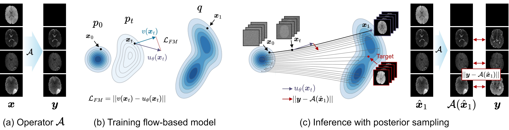

# Paper
[ECCV 2026] Posterior Samplings are Missing Modalities Generators for Medical Image Translation <br>

[](https://arxiv.org/abs/2607.18763)<br>

## Overview

This repository contains the code for Posterior Samplings are Missing Modalities Generators for Medical Image Translation.




## Setup

Quick setup instructions to install dependencies and prepare the environment.


```bash
conda env create -f environment.yml
conda activate ps-mit

pip install -e .
pip install torch-fidelity --no-deps
```


## Train

For the BraTS dataset, the model is trained as flow matching models that generates images in which each sample has four channels, corresponding to different modalities (T1, T2, T1ce, FLAIR). 


```bash
device=0

CUDA_VISIBLE_DEVICES=$device torchrun --standalone --nproc_per_node=1 train.py \
  --data_path dataset/BraTS2023 \
  --dataset brats --image_size 224 --batch_size 16 --eval_frequency 1 --epochs 10000 \
  --output_dir ./output/unet --lr 1e-4 --decay_lr \
  --resume checkpoint.pth
```


## Inference

Posterior sampling methods such as DPS, DDNM, PSLD, FlowChef, and FlowDPS are available and can be selected.

For many-to-one sampling, use the `--missing_channels` with a single value. <br>
For many-to-many sampling, use the `--missing_channels` with multiple values.


```bash
method="psld" # dps, ddnm, flowchef, flowdps
step_size=0.025
device=0

# many to one
CUDA_VISIBLE_DEVICES=$device torchrun --standalone --nproc_per_node=1 sample.py \
    --data_path /store4/01.Database/01.Brain/04.BraTS2021/TrainingData \
    --dataset brats --image_size 224 --batch_size 1 \
    --sample_dir ./samples/unet --ode_method euler \
    --resume checkpoint.pth --method $method --missing_channels 1 --source_channels 0 2 --step_size $step_size
    
# many to many
CUDA_VISIBLE_DEVICES=$device torchrun --standalone --nproc_per_node=1 sample.py \
    --data_path /store4/01.Database/01.Brain/04.BraTS2021/TrainingData \
    --dataset brats --image_size 224 --batch_size 1 \
    --sample_dir ./samples/unet --ode_method euler \
    --resume checkpoint.pth --method $method --missing_channels 1 3 --source_channels 0 2 --step_size $step_size
```


## Datasets

We utilized the BraTS 2023 and IXI dataset. Accessible links are provided below. 

BraTS 2023: https://www.synapse.org/Synapse:syn51156910

IXI: https://brain-development.org/ixi-dataset/ 


## Pretrained Model

model weight: [google drive](https://drive.google.com/file/d/14KsmbJX33bcGgQOWO0UVB7JXIC-oz7Vb/view?usp=sharing)


# Citation

```bibtex
@article{kim2026posterior,
  title={Posterior Samplings are Missing Modalities Generators for Medical Image Translation},
  author={Kim, Jonghun},
  journal={arXiv preprint arXiv:2607.18763},
  year={2026}
}
```


